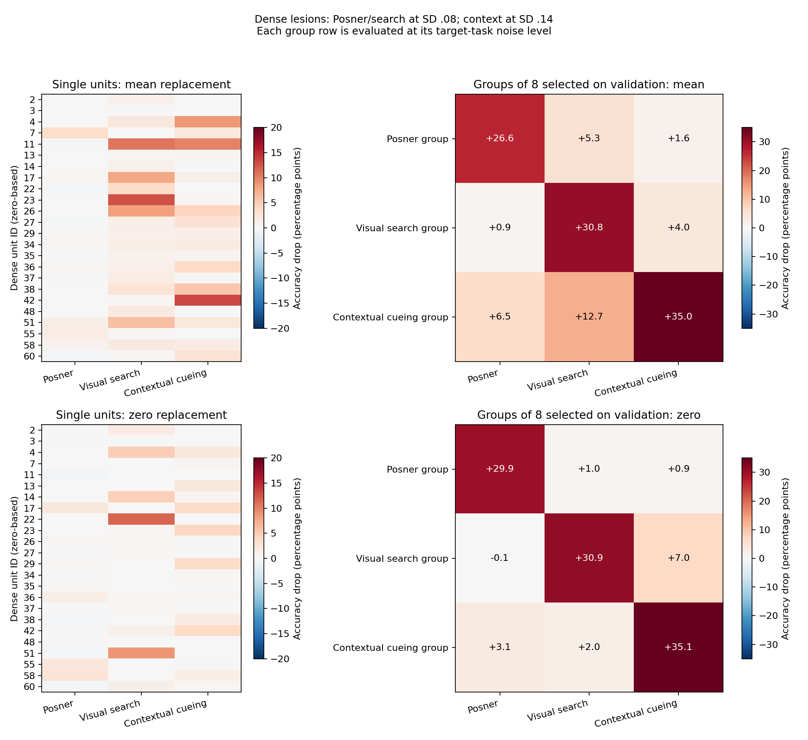
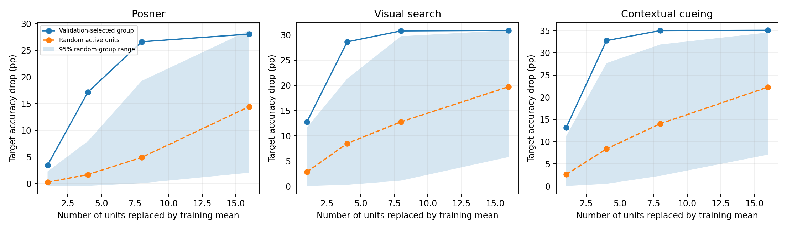
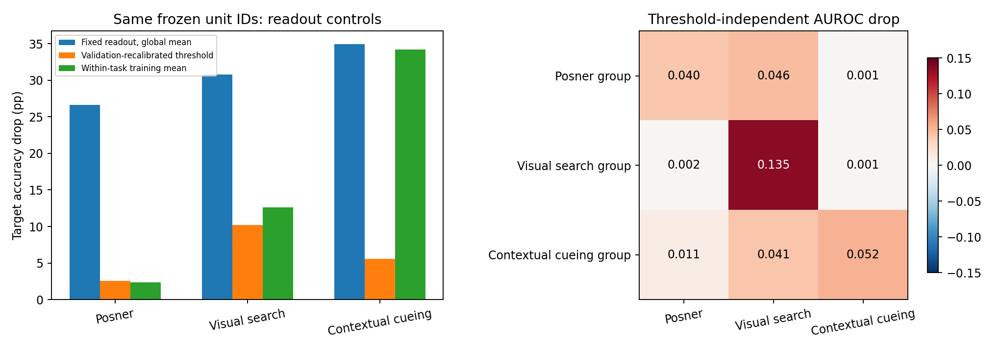
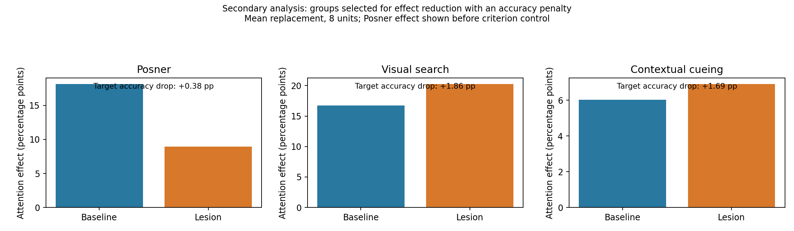
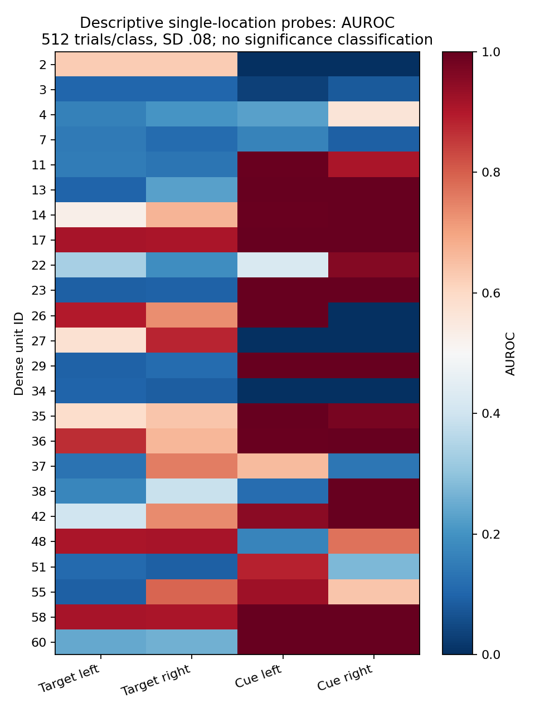

# Lezje neuronów małej CNN — wyniki eksperymentu

**Wniosek:** konkretne grupy jednostek wpływają przyczynowo na decyzje tej sieci, lecz duże spadki accuracy częściowo wynikają z przesunięcia kryterium odpowiedzi. Najbardziej stabilną specjalizację informacyjną potwierdzono dla visual search; słabszą dla kontekstu. Pierwotna selektywność grupy Posnera nie utrzymuje się po kontroli progu. Osobna analiza wskazuje częściowy wpływ innej grupy na cueing Posnera. Dla efektów search i contextual cueing główny wariant nie potwierdził selektywnej redukcji na nowych próbach.

## Model i protokół

Analizowany checkpoint: epoka 25, SHA256 `8afe9a2581c06c753011d30ffb35c09b573fc3445a4a6e0e1ebf628a6f5c7059`. Wagi pozostały zamrożone. Interwencja dotyczy 64 aktywacji po ReLU w `classifier[2]`, przed liniowym wyjściem. Identyfikatory neuronów są liczone od zera.

Na 30 000 prób kalibracyjnych ze zbioru treningowego zmienną aktywność miały **24 z 64 jednostek**. Aktywne ID: [2, 3, 4, 7, 11, 13, 14, 17, 22, 23, 26, 27, 29, 34, 35, 36, 37, 38, 42, 48, 51, 55, 58, 60]. Kontrole losowe obejmowały te jednostki; nie losowano głównie nieaktywnych neuronów.

Wybór grup: 2000 nowych prób na zadanie, seed 7142. Potwierdzenie: **8000 nowych prób na zadanie**, łącznie 24,000, seed 8143, przy każdym z SD 0,04 / 0,08 / 0,14. Pary baseline–lezja otrzymują identyczny obraz i szum. Nowe konfiguracje kontekstu są rozłączne z treningiem, wyborem i poprzednim testem. Stare konfiguracje z definicji się powtarzają.

Zastępowanie aktywacji: **mean** = globalna średnia z treningu (bez znajomości zadania); **zero** = 0. Kontrole: 200 losowych grup aktywnych jednostek dla każdej wielkości 4, 8 i 16; dla pojedynczych jednostek wszystkie aktywne ID. Jedna próba szumu przypada na każdy czysty obraz w danym warunku; nie traktujemy kolejnych skal szumu jako niezależnych replikacji sieci.

Główny wariant ustalony w kodzie przed oceną potwierdzającą: **8 jednostek, mean, strategia selective**. Posner i search oceniane przy SD=0,08, kontekst przy SD=0,14, aby ograniczyć efekt sufitu. Dobór zachłanny na walidacji zwiększa względny przyrost cross-entropy celu i odejmuje średni dodatni przyrost straty pozostałych zadań. Dodatkowo zbadano strategię importance, grupy 1/4/16 i zero; są zapisane w JSON.

Główna trafność jest liczona przy znanym zadaniu (dwie odpowiednie klasy). Osobno zapisano wynik sześciu klas i rozpoznawanie rodzaju zadania, aby odróżnić deficyt decyzji od deficytu rozpoznania zadania.

## 1. Wpływ grup na rozwiązywanie zadań

Pierwsza tabela pokazuje interwencję przy oryginalnym, zamrożonym odczycie. Nie należy interpretować całego spadku accuracy jako utraty informacji: niżej znajdują się kontrole progu i AUROC.

| Grupa wybrana dla | SD | ID neuronów | Accuracy przed → po | Spadek (95% CI), pp | Spadki innych zadań, pp | q względem losowych grup |
|---|---:|---|---:|---:|---|---:|
| Posner | 0.08 | [7, 51, 34, 58, 36, 48, 3, 14] | 79.89% → 53.29% | 26.60 (25.33–27.94) | Visual search: +5.34, Contextual cueing: +1.57 | 0.0149 |
| Visual search | 0.08 | [23, 11, 51, 27, 37, 2, 35, 36] | 80.92% → 50.12% | 30.80 (29.43–32.11) | Posner: +0.94, Contextual cueing: +3.96 | 0.0224 |
| Contextual cueing | 0.14 | [42, 38, 36, 26, 27, 51, 34, 29] | 85.06% → 50.09% | 34.98 (33.92–36.01) | Posner: +6.47, Visual search: +12.70 | 0.0249 |

**Jednostki wspólne dla wszystkich trzech głównych grup: [36, 51].** Grupy nie są rozłącznymi modułami. Szczególnie grupa kontekstowa wpływa również na pozostałe zadania. Wyniki pokazują względną specjalizację w tej sieci, a nie absolutną wyłączność funkcji.

Selektywność testowa = spadek accuracy zadania docelowego minus największa bezwzględna zmiana pozostałych zadań. q oznacza korektę Benjamini–Hochberga trzech porównań dla empirycznych ogonów rozkładu 200 losowych grup; minimalna wartość surowego p wynosi 1/201. To porównanie grup wewnątrz jednej sieci, nie test populacji niezależnych treningów.

CI: sparowany bootstrap 1500 powtórzeń. W kontekście stare próby są resamplowane na poziomie 16 powtarzanych konfiguracji; nowe osobno. CI warunkowe względem wybranego checkpointu i grup nie obejmuje zmienności treningu ani procedury wyboru grup.

### Kontrola: te same ID przy zerowaniu

Poniżej zerujemy dokładnie grupy wybrane dla mean; nie zastępujemy ich innymi, ponownie wybranymi ID.

| Grupa | Spadek Posner, pp | Spadek search, pp | Spadek context, pp |
|---|---:|---:|---:|
| posner | +10.42 | +16.96 | +1.46 |
| search | -0.09 | +11.59 | +3.91 |
| context | +2.85 | +8.11 | +10.62 |

Zmiana definicji interwencji zmienia selektywność tych samych ID. Przykładowo grupa Posnera wybrana dla mean przy zerowaniu silniej pogarsza search niż Posnera. To ogranicza wniosek o stałej, niezależnej od interwencji grupie wyspecjalizowanej w Posnerze.

### Kontrola informacji i odczytu: kluczowa dla interpretacji

Zamiana aktywacji na globalną średnią może przesunąć logity, powodując częste wybieranie jednej klasy. Zbadano więc: (1) AUROC niezależne od progu, (2) diagnostyczne przekalibrowanie wyłącznie progu decyzji na walidacji — osobno dla baseline i sieci po lezji, (3) zastępowanie aktywacji średnią treningową warunkowaną rodzajem zadania. Ostatnia kontrola zachowuje przeciętną aktywność w danym zadaniu. Są to analizy diagnostyczne po głównym eksperymencie; nie zmieniają oryginalnego checkpointu ani wybranych grup.

| Grupa | AUROC celu przed → po | Spadek accuracy po kalibracji, pp | Największy bezwzględny spadek innych zadań po kalibracji, pp | Spadek celu przy średniej dla zadania, pp |
|---|---:|---:|---:|---:|
| posner | 0.8825 → 0.8425 | 2.54 | 5.20 | 2.38 |
| search | 0.8941 → 0.7593 | 10.21 | 0.98 | 12.65 |
| context | 0.9278 → 0.8760 | 5.55 | 3.36 | 34.19 |

**Interpretacja:** dla search spadek informacji i trafności pozostaje selektywny po kontroli odczytu. Dla kontekstu pozostaje słabsza względna specjalizacja. Dla grupy Posnera po kalibracji większy deficyt występuje w search niż w Posnerze; pierwotna duża różnica przy stałym progu nie potwierdza zatem selektywnej utraty informacji Posnera. Grupa kontekstowa przy średniej warunkowej nadal może silnie przesuwać kryterium: sam ten wariant również nie zastępuje kontroli AUROC i kalibracji.


### Najsilniejsze pojedyncze jednostki (mean)

| Zadanie | ID: spadek accuracy, pp |
|---|---|
| Posner | 7: +3.46, 55: +1.41, 51: +1.20 |
| Visual search | 23: +12.75, 11: +10.76, 26: +8.15 |
| Contextual cueing | 42: +13.15, 11: +9.89, 4: +8.70 |

## 2. Grupy odpowiadające za efekty uwagowe

To osobny dobór na walidacji. Cel = zmniejszenie odpowiedniego efektu minus dwukrotność dodatniego spadku accuracy zadania docelowego; k=8. Kontrole losowe oceniono tą samą funkcją. Grupy nie były optymalizowane do oszczędzania pozostałych dwóch zadań — ich wyniki zapisano w JSON.

Efekt Posnera = HR valid − HR invalid, tylko dla widocznych ramek (kontrast >0). Efekt search = accuracy SS1 − SS8. Efekt kontekstu = accuracy old − new. Zanik efektu po sprowadzeniu całego zadania do losowości sam w sobie nie dowodzi selektywnej lezji mechanizmu uwagi.

| Zadanie | ID neuronów (mean) | Efekt przed → po, pp | Spadek accuracy zadania, pp | 95% CI zmniejszenia efektu, pp | q surowego celu względem losowych grup |
|---|---|---:|---:|---:|---:|
| posner | [17, 29, 38, 42, 26, 2, 11, 34] | 18.14 → 8.93 | +0.38 | +6.03 do +12.42 | 0.0149 |
| search | [3, 7, 60, 2, 13, 42, 55, 34] | 16.75 → 20.25 | +1.86 | -5.40 do -1.62 | 0.0846 |
| context | [29, 3, 48, 22, 2, 55, 35, 37] | 6.03 → 6.90 | +1.69 | -1.85 do +0.14 | 0.0672 |

### Posner: oddzielenie zmiany czułości od progu decyzji

Surowy hit-rate gap zmniejszył się o 9.21 pp przy spadku accuracy Posnera 0.38 pp. Jednocześnie FAR w próbach z widoczną ramką wzrósł z 17.16% do 23.71%. Część pozornego usunięcia efektu jest więc związana ze zmianą kryterium odpowiedzi.

Próg dla sieci po lezji wyznaczono wyłącznie na walidacji, dopasowując FAR do baseline. Na nowych próbach FAR wyniósł 17.33% wobec 17.16% baseline. Hit-rate gap po tej kontroli: 18.14 → 13.67 pp. Redukcja wynosi **4.47 pp**, opisowe 95% CI 1.86–7.25 pp.

Różnica AUROC valid–invalid, niezależna od stałego progu, zmalała z 0.0692 do 0.0606. To opisowa kontrola; nie wykonano osobnego testu istotności AUROC.

Ten wynik daje częściową przesłankę wpływu grupy na cueing w wariancie mean. Nie oznacza izolacji uniwersalnego modułu uwagi: grupa zmienia także inne zadania, a kontrola progu jest analizą diagnostyczną po głównym eksperymencie.

Dla zerowania grup wybranych pod zero oraz dla tych samych ID wybranych pod mean pełne wyniki kontroli są w `attention_results.json` i `cross_replacement_checks.json`. Wyniku mean nie należy automatycznie przenosić na zero.

**Visual search i contextual cueing:** główne grupy mean wybrane do zmniejszenia efektów nie potwierdziły takiej funkcji na nowych próbach. Efekty po lezji nawet wzrosły. Warianty zero są wynikami dodatkowymi; same nie stanowią potwierdzenia stabilnej, niezależnej od definicji lezji grupy mechanizmu uwagi.

## 3. Strojenie pojedynczych jednostek

Zapisano AUROC aktywacji każdego neuronu względem etykiety każdego zadania przy trzech poziomach szumu (`task_label_tuning.csv`). Dodatkowo wykonano kontrolowane sondy Posnera: cel/dystraktor tylko w jednej lokalizacji, z ramką i bez niej, oraz sama ramka vs tło. Po 512 prób na klasę, SD=0,08, niezależny szum.

`posner_tuning_probes.csv` zawiera AUROC dla celu, wskazówki oraz zmianę bezwzględnej czułości na cel przy dodaniu ramki. To opisowe sondy. Nie zastosowano klasyfikacji typów neuronów opartej na istotności/FDR ani pełnego zestawu bodźców z PNAS. Te wyniki nie uprawniają jeszcze do przypisania jednostek do mechanizmów location-opponent / summation.

## Kontrole i zakres wniosków

- Zgodność obliczeń na zapisanych aktywacjach z rzeczywistym forward hookiem sprawdzono liczbowo; wynik w `verification.json`.
- Testy sprawdzają interwencję end-to-end, brak informacji o obrazie po wyłączeniu całej warstwy oraz korektę wielokrotnych porównań.
- Grupy wybrano na walidacji i zamrożono przed oceną potwierdzającą. Nie wybierano najlepszego k ani najlepszego poziomu szumu na teście.
- Analiza dotyczy jednej sieci, jednej warstwy oraz obecnej adaptacji bodźców 64×64. ID jednostek nie przenoszą się między treningami. Do wniosku o powtarzalnym mechanizmie potrzebne są niezależne sieci i dalsze analizy warstw konwolucyjnych.
- Lezje wskazują przyczynowy wpływ aktywacji w tym modelu i przy tych interwencjach. Nie dowodzą analogicznej organizacji biologicznej ani tego, że istnieje tylko jeden taki zestaw jednostek.

## Wykresy











## Odtworzenie

Z katalogu głównego projektu:

```bash
python3 -m unittest discover -s small_cnn -p "test_lesion.py" -v
python3 small_cnn/lesion.py
python3 small_cnn/lesion_attention.py
python3 small_cnn/lesion_checks.py
python3 small_cnn/lesion_readout_controls.py
MPLCONFIGDIR=tmp/matplotlib python3 small_cnn/summarize_lesion.py
```

Surowe wyniki: `results.json`, `single_unit_lesions.csv`, `selected_groups.json`, `attention_results.json`, `cross_replacement_checks.json`, `readout_controls.json`. Aktywacje i metadane pozwalają odtworzyć analizy bez ponownego przejścia przez warstwy konwolucyjne.
