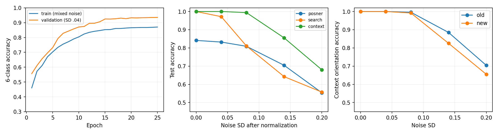
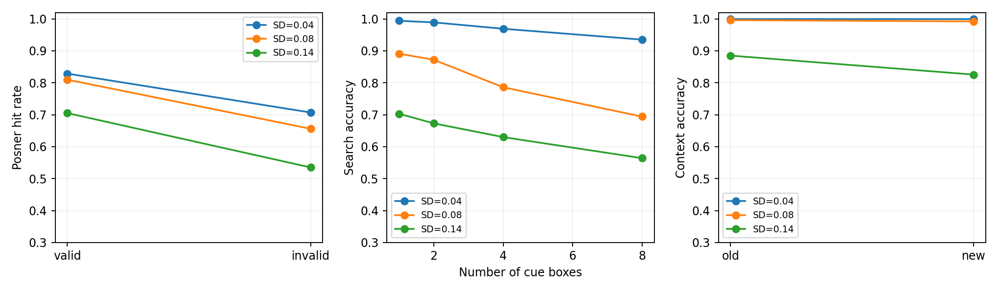

# Wyniki jednej małej CNN dla trzech zadań

Model: **142,366 parametrów**, najlepsza epoka 25; pełny trening 13.3 min na CPU.

Checkpoint wybrano wyłącznie na walidacji przy SD=0,04. Test: 4 000 prób na zadanie (12 000 ogółem).

## Trafność na odłożonym zbiorze testowym

Głównym warunkiem jest SD=0,04, ustalone przed treningiem. Decyzja spośród sześciu klas; przypadkowa decyzja przy znanym zadaniu to 50%.

| Zadanie | Accuracy | 95% CI Wilsona | Accuracy przy znanym zadaniu |
|---|---:|---:|---:|
| posner | 83.23% | 82.04%–84.35% | 83.23% |
| search | 97.17% | 96.61%–97.64% | 97.17% |
| context | 100.00% | 99.90%–100.00% | 100.00% |

Dla Posnera optymistyczny obserwator z bezszumowym dostępem do ukrytych kątów i strony wskazówki osiąga około 84,64% (milion prób, `angle_oracle.py`). Nakładanie rozkładów kątów wyklucza oczekiwanie 100% trafności. To inny benchmark niż obrazowy BIO z publikacji.

## Odporność na szum

| SD | Posner | Search | Context |
|---|---:|---:|---:|
| 0 | 84.12% | 100.00% | 100.00% |
| 0.04 | 83.23% | 97.17% | 100.00% |
| 0.08 | 80.90% | 81.08% | 99.40% |
| 0.14 | 70.45% | 64.25% | 85.52% |
| 0.2 | 55.40% | 55.77% | 68.00% |

## Efekty uwagowe

Nie utożsamiamy hit rate z accuracy: valid i invalid dotyczą tylko prób z celem. False alarm rate liczymy osobno na próbach bez celu. Wyniki Posnera poniżej agregują cztery kontrasty ramki, także zerowy.

| SD | Posner HR valid | Posner HR invalid | FAR | Search SS1 | SS2 | SS4 | SS8 | Context old | new |
|---|---:|---:|---:|---:|---:|---:|---:|---:|---:|
| 0.04 | 82.86% | 70.70% | 13.90% | 99.40% | 98.90% | 96.90% | 93.50% | 100.00% | 100.00% |
| 0.08 | 80.97% | 65.62% | 16.00% | 89.10% | 87.20% | 78.60% | 69.40% | 99.60% | 99.20% |
| 0.14 | 70.51% | 53.51% | 26.10% | 70.30% | 67.30% | 63.00% | 56.40% | 88.50% | 82.55% |
| 0.2 | 44.23% | 35.84% | 22.55% | 59.00% | 56.60% | 56.10% | 51.40% | 70.45% | 65.55% |

W tej jednej sieci występują wszystkie trzy oczekiwane tendencje behawioralne:

- Posner, SD=0,04: hit rate valid 82.86%, invalid 70.70%, FAR 13.90%.
- Search, SD=0,04: accuracy dla set size 1: 99.40%; dla set size 8: 93.50%.
- Context, SD=0,14: old 88.50%, new 82.55%. Przy SD=0,04: old 100.00%, new 100.00%. Sufit trafności może ukrywać efekt kontekstu.

To opis obserwowanych różnic. Nie przeprowadzono testu istotności uwzględniającego klastrowanie starych kontekstów ani powtórzeń treningu. Warunek SD=0,14 pokazano jako jeden z wcześniej ustalonych poziomów szumu; nie jest nowym kryterium wyboru modelu.

## Zakres wniosków

To pomiary na wygenerowanych danych w jawnie opisanej adaptacji procedury, a nie pełna replikacja publikacji ani wynik na gotowym oryginalnym zbiorze obrazów. Rozdzielczość 64×64, antyaliasing, uproszczenia geometrii i mieszanka szumu zmieniają trudność. Wynik przy SD=0,04 nie oznacza wyniku przy szumie publikacji. Jedna inicjalizacja nie wystarcza do oceny stabilności efektów między sieciami.

Przedziały Wilsona są opisowe dla jednej sieci; powtarzane konteksty nie są niezależnymi konfiguracjami. Nie przeprowadzono walidacji neuronalnej ani dopasowania do danych ludzi, więc wysoka trafność nie potwierdza mechanizmów pojedynczych jednostek z PNAS. Należy patrzeć osobno na odczyt orientacji/detekcję i różnice między warunkami.

Stare tła są świadomie wspólne między treningiem a testem, ale szum jest nowy, a etykiety orientacji zbalansowane. Nowe tła są rozłączne między splitami. `split_audit.json` dokumentuje to rozróżnienie. Surowe predykcje zawierają metadane każdej próby.

Wyniki testowe nie były używane do wyboru checkpointu. Szczegóły celu prac, danych i odstępstw: `../ANALIZA.md`.

